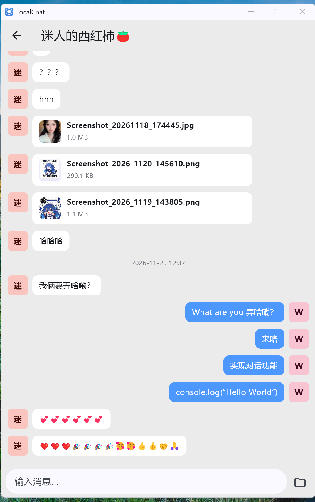
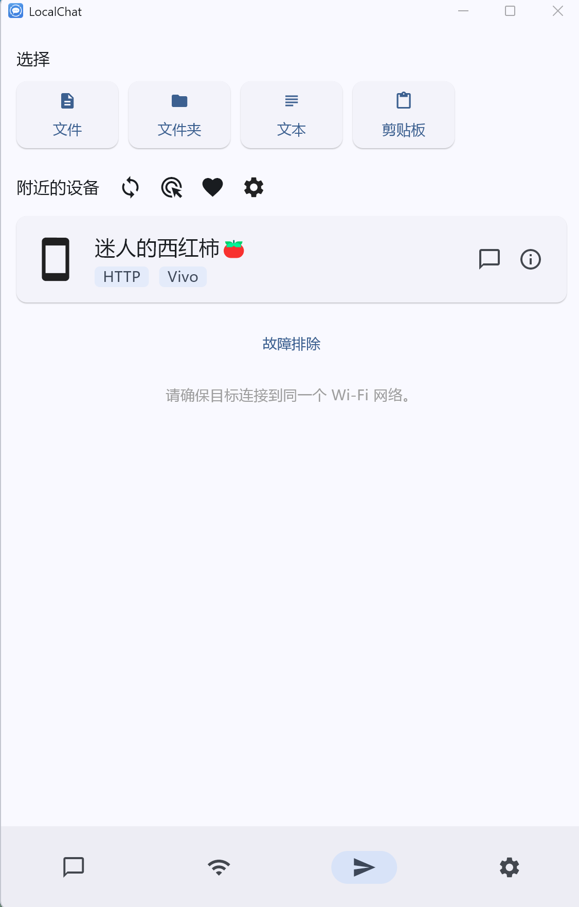

# LocalChat

**English** · [简体中文](README.zh-CN.md)

Send files and messages to devices on your local network — no internet, no account, no server in between.

LocalChat keeps the transfer engine and wire protocol of [LocalSend](https://github.com/localsend/localsend), and replaces the one-shot "pick files → send" flow with a list of peers you can talk to repeatedly.

[**Download**](https://github.com/CC-play/LocalChat/releases) · [Protocol spec](https://github.com/localsend/protocol)

## Screenshots

<p align="center">
  
  
  
</p>

Resize the window and the tab bar moves: a rail down the left side while the window is wide, a bar across the bottom once it is narrower than 700 px.

<p align="center">
  
  
</p>

## Features

- **Conversations** — peers are grouped into a chat list sorted by recent activity, with a full history in both directions.
- **Send from anywhere** — drop files onto a conversation, or paste files, images and text with `Ctrl/Cmd+V`.
- **Progress inside the bubble** — upload progress is drawn in the message itself; long transfers can be cancelled, failed ones resent with one click.
- **Composer semantics** — `Enter` sends, `Shift+Enter` breaks the line; on Android, long-press the send button.
- **Interoperable** — same endpoints, same port, same multicast group, so it still talks to a stock LocalSend.

## Status

`0.1.0` — Windows and Android are built and tested. Linux, macOS and iOS come from the upstream codebase and have not been verified.

| Platform | Package | Notes |
|---|---|---|
| Windows 10+ | `LocalChat-<version>-win-x64.zip` | Portable: extract, run `localchat_app.exe` |
| Android 7.0+ (API 24) | `LocalChat-<version>-android.apk` | Sideload; package `com.localchat.app` |

Allow `TCP/UDP 53317` through the firewall on first launch, otherwise devices will not find each other. If they still don't, check that the router has AP isolation disabled.

## Build

Requires [Flutter](https://flutter.dev) (version pinned in `.fvmrc`) and [Rust](https://www.rust-lang.org/tools/install).

```bash
cd app
flutter pub get
flutter run                        # or: flutter build windows --release
```

Close a running instance before rebuilding on Windows — the linker cannot overwrite a locked executable.

## Notes

- Text messages are ordinary `FileType.text` transfers, so a stock LocalSend receives them as a `.txt` file.
- Settings live in `%APPDATA%\LocalChat\` on Windows. Drop an empty `settings.json` next to the executable for portable mode.
- Engineering guide: [AGENTS.md](AGENTS.md). Conversation design: [aoci/modules/conversation.md](aoci/modules/conversation.md).

## Support

LocalChat is built in spare time and given away for free. If it saves you some trouble, a coffee is welcome — entirely optional.


The same code is in the app under **Settings → Other information → Donate**.

## License

Apache-2.0, inherited from the upstream project — see [LICENSE](LICENSE).

LocalChat is an unofficial fork and is not affiliated with the LocalSend project. Upstream is the work of [Tien Do Nam (@Tienisto)](https://github.com/Tienisto) and its contributors. Fork-specific issues belong here, not in the upstream tracker.
