# LocalChat

LocalChat is a free, open-source app that lets you send files and messages to nearby devices over your local network — no internet connection, no account, no server in the middle.

It is a personal **fork of [LocalSend](https://github.com/localsend/localsend)** that keeps the original transfer engine and adds a conversation-style UI on top of it: pairing is no longer a one-shot "pick files → send" flow, but a list of peers you can talk to repeatedly.

> [!IMPORTANT]
> This is an unofficial fork and is **not** affiliated with the LocalSend project. Upstream is the work of [Tien Do Nam (@Tienisto)](https://github.com/Tienisto) and its contributors. Bug reports about this fork do not belong in the upstream issue tracker.

[Upstream homepage][homepage] • [Upstream GitHub][github] • [Upstream Codeberg][codeberg] • [LocalSend protocol][protocol]

## What this fork changes

- **Conversations.** Peers are aggregated into a chat-style list, ordered by the most recent activity, with a bidirectional history. Transfers started from the classic "Send" tab still behave exactly as before.
- **Send into a conversation.** Drag files onto a conversation window, or paste from the clipboard (Ctrl/Cmd+V) — images, files, or plain text. Both paths share one confirmation sheet.
- **Per-bubble transfer feedback.** Upload progress is rendered inside the message bubble; long transfers can be cancelled, and failed messages can be resent by clicking the red exclamation mark.
- **Text composer.** Enter sends, Shift+Enter inserts a newline. On Android, long-press the send button to insert a newline (the soft keyboard cannot report a long-press on its return key).
- **Chat rendering of text messages.** A message is still a single-file `FileType.text` request with the body in `preview`, so no new endpoint is introduced — see the next section.

## What is *not* changed

Wire compatibility is a hard requirement: a LocalChat device must still talk to a stock LocalSend installation.

- Endpoints stay at `/api/localsend/v1/...` and `/api/localsend/v2/...`
- The default port stays `TCP/UDP 53317`, multicast discovery stays on `224.0.0.167`
- The Android application id stays `org.localsend.localsend_app`, the iOS bundle id stays `org.localsend.localsendApp`
- The Rust core crate is still named `localsend`, the FRB plugin crate is still `rust_lib_localsend_app`

Renaming any of those would silently break interoperability with other clients or require regenerating the generated bindings, so they are deliberately left alone. User-visible names — window title, package display name, executable `localchat_app`, CLI `localchat-cli` — are renamed.

## Repository layout

| Path                           | What it is                                                               |
|--------------------------------|--------------------------------------------------------------------------|
| `app/`                         | Flutter app (`localchat_app`): UI, providers, persistence, native channels |
| `packages/localchat_isolates/` | Dart isolate layer + `flutter_rust_bridge` bindings                       |
| `packages/core/`               | Rust crate `localsend`: protocol, HTTP server/client, crypto, WebRTC      |
| `server/`, `cli/`              | Headless server and the `localchat-cli` terminal client                   |
| `aoci/`                        | AI-oriented code index: routing, invariants, fork insertion points        |

See [AGENTS.md](AGENTS.md) for the engineering guide and [aoci/index.md](aoci/index.md) for the intent → file routing table.



## Getting started

1. Install [Flutter](https://flutter.dev) (see [.fvmrc](.fvmrc) for the version this repository is built with) or use [fvm](https://fvm.app)
2. Install [Rust](https://www.rust-lang.org/tools/install)
3. Clone this repository
4. `cd app`
5. `flutter pub get`
6. `flutter run`

> [!NOTE]
> The pub workspace is rooted at the repository root, so `pub get` from any member resolves all Dart packages at once. `packages/localchat_isolates` additionally needs its own `build_runner` run when its models change.

### Building

Run from the `app` directory.

```bash
flutter build windows     # -> build/windows/x64/runner/Release/localchat_app.exe
flutter build apk         # Android
flutter build linux       # Linux
flutter build macos       # macOS
flutter build ipa         # iOS
```

Close a running instance before rebuilding on Windows, otherwise the linker fails with `LNK1168` because the executable is locked.

### Running the CLI

```bash
cargo run -p localchat-cli -- --help
```

## Setup

In most cases LocalChat works out of the box. If devices cannot find each other, allow the app through the firewall.

| Traffic Type | Protocol | Port  | Action |
|--------------|----------|-------|--------|
| Incoming     | TCP, UDP | 53317 | Allow  |
| Outgoing     | TCP, UDP | Any   | Allow  |

Also make sure AP isolation is disabled on the router — it is usually off by default, but some routers (especially guest networks) enable it.

**Portable mode.** Create an empty file named `settings.json` next to the executable; settings are then stored there instead of `%APPDATA%\LocalChat`.

**Start hidden.** `localchat_app.exe --hidden` starts the app in the tray only.

## Storage locations

| Platform         | Location                                                                                        |
|------------------|-------------------------------------------------------------------------------------------------|
| Windows          | `%APPDATA%\LocalChat\settings.json`                                                             |
| Android          | app-private storage of `org.localsend.localsend_app` (unchanged by the rename, so data is kept)  |
| Desktop portable | `settings.json` next to the executable                                                           |

Settings written by this fork before the rename lived in `%APPDATA%\LocalSend\settings.json`. On first start the old file is moved to the new location, so conversations, favorites, window placement and the TLS key survive the rename.

## How it works

LocalChat speaks the LocalSend protocol: devices announce themselves over multicast, then exchange files through a REST API over HTTPS, with a self-signed certificate generated on the fly on each device. The protocol itself is documented in the upstream [specification][protocol].

For the conversation feature specifically, read [aoci/modules/conversation.md](aoci/modules/conversation.md) — it describes how chat events are projected onto the transfer engine without touching it.

## Documentation languages

`support/readme/` contains the **upstream** README translations, kept verbatim for reference. They describe the upstream project, including its download badges and store links, and are not maintained for this fork.

## Troubleshooting

| Issue              | Platform (Sending) | Platform (Receiving) | Solution                                                                                |
|--------------------|--------------------|----------------------|-----------------------------------------------------------------------------------------|
| Device not visible | Any                | Any                  | Make sure AP isolation is disabled on the router. If enabled, connections between devices are forbidden. |
| Device not visible | Any                | Windows              | Set the network profile to "private". Windows is more restrictive on public networks.     |
| Device not visible | macOS, iOS         | Any                  | Toggle the "Local Network" permission under "Privacy" in the OS settings.                 |
| Speed too slow     | Any                | Any                  | Use 5 GHz; disable encryption on both devices.                                            |

Stuck sending? Open the conversation, click the spinner to cancel, then the red exclamation mark to resend. The retry window is two minutes; a transfer that makes no progress for 60 seconds is marked as failed.

## License and attribution

Apache-2.0, inherited from the upstream project. Copyright remains with the original author and contributors; see [LICENSE](LICENSE) and the in-app license notices.

[homepage]: https://localsend.org
[github]: https://github.com/localsend/localsend
[codeberg]: https://codeberg.org/localsend/localsend
[protocol]: https://github.com/localsend/protocol
