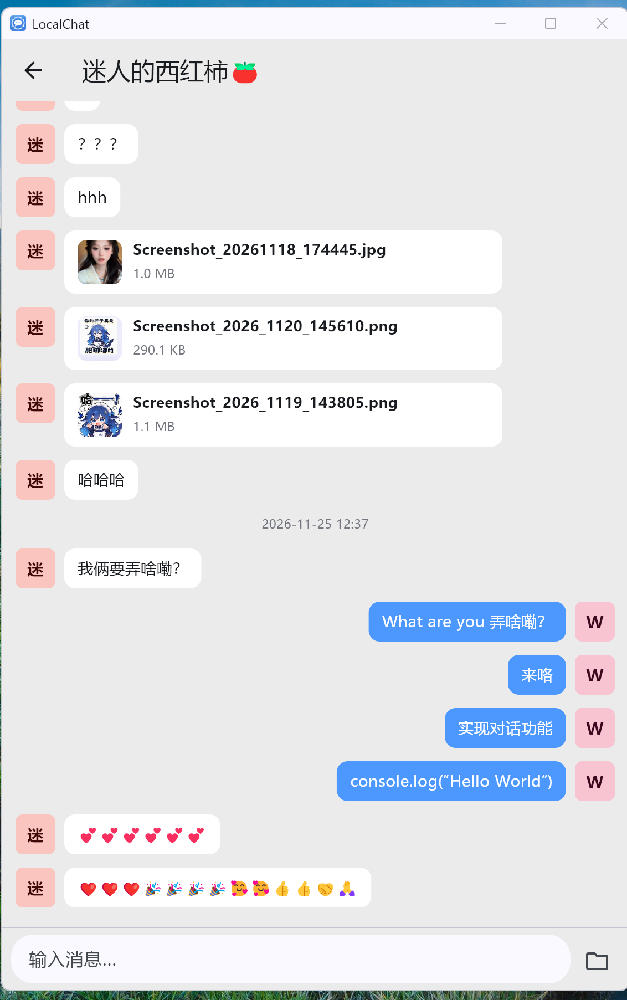
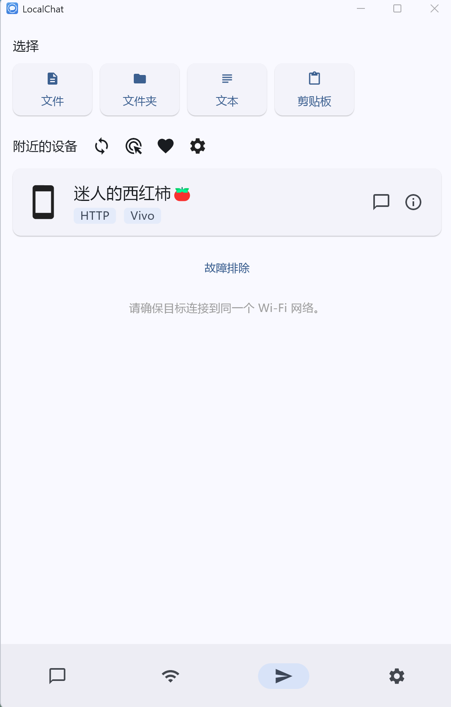
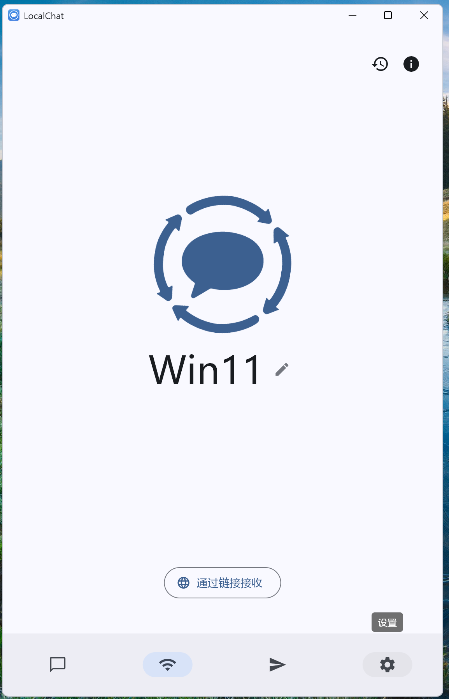
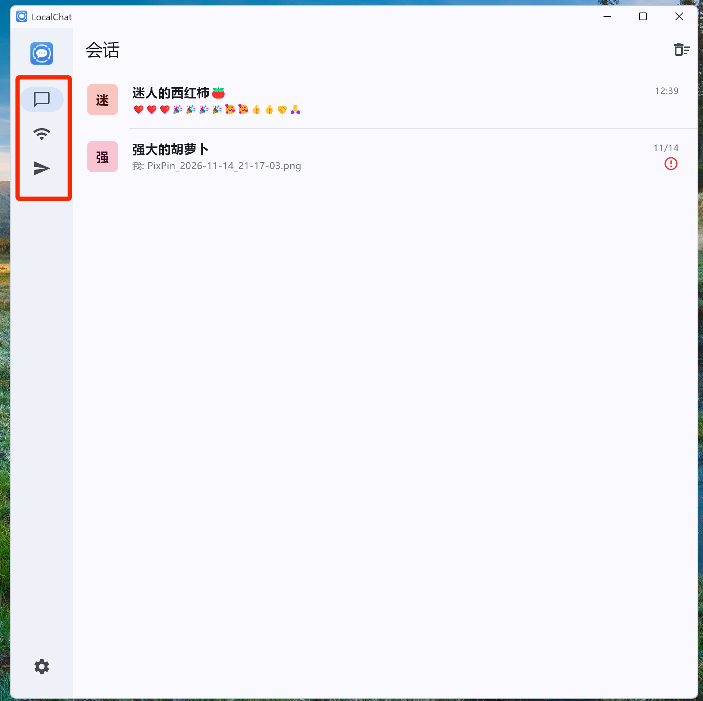
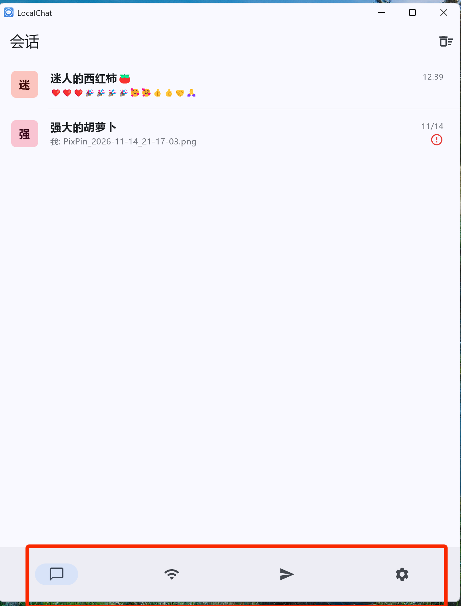

# LocalChat

[English](README.md) · **简体中文**

在局域网内向附近设备发送文件和消息 —— 不需要联网、不需要账号、没有中转服务器。

LocalChat 沿用 [LocalSend](https://github.com/localsend/localsend) 的传输引擎与通信协议，把「选文件 → 发送」这种一次性动作，换成可以反复对话的联系人列表。

[**下载**](https://github.com/CC-play/LocalChat/releases) · [协议规范](https://github.com/localsend/protocol)

## 截图

<p align="center">
  
  
  
</p>

调整窗口宽度，标签栏位置会变化：窗口较宽时是左侧图标栏，窄于 700 px 后变成底部标签栏。

<p align="center">
  
  
</p>

## 功能

- **会话列表** —— 对端按最近活跃时间聚合成聊天列表，双向保留历史记录。
- **随处发送** —— 把文件拖到会话窗口，或用 `Ctrl/Cmd+V` 粘贴文件、图片和文本。
- **气泡内进度** —— 上传进度直接画在消息气泡里；长传输可取消，失败的点击即可重发。
- **输入框语义** —— `Enter` 发送、`Shift+Enter` 换行；Android 上长按发送按钮换行。
- **保持互通** —— 接口路径、端口、组播地址均未改动，仍能与原版 LocalSend 互相收发。

## 当前状态

`0.2.0` —— Windows 与 Android 已构建并实测。Linux、macOS、iOS 直接来自上游代码，尚未验证。

| 平台 | 发布包 | 说明 |
|---|---|---|
| Windows 10+ | `LocalChat.zip` | 绿色版：解压后运行 `LocalChat.exe` |
| Android 7.0+（API 24） | `LocalChat.apk` | 侧载安装；包名 `com.localchat.app` |

首次启动请在防火墙中放行 `TCP/UDP 53317`，否则设备之间无法互相发现。仍然找不到时，检查路由器是否开启了 AP 隔离。

## 构建

需要 [Flutter](https://flutter.dev)（版本见 `.fvmrc`）与 [Rust](https://www.rust-lang.org/tools/install)。

```bash
cd app
flutter pub get
flutter run                        # 或 flutter build windows --release
```

Windows 上重新构建前请先关闭正在运行的实例，否则链接器无法覆盖被占用的可执行文件。

## 说明

- 文本消息本质是一次普通的 `FileType.text` 传输，因此原版 LocalSend 收到后显示为一个 `.txt` 文件。
- Windows 配置存放在 `%APPDATA%\LocalChat\`；若在可执行文件旁放一个空的 `settings.json`，则切换为便携模式。
- 工程指南见 [AGENTS.md](AGENTS.md)，会话功能的设计说明见 [aoci/modules/conversation.md](aoci/modules/conversation.md)。

## 打赏

LocalChat 是业余时间开发的，免费分发。如果它帮你省了点事，欢迎扫码请我喝杯咖啡 —— 完全自愿。


应用内同一张码的位置：**设置 → 其他信息 → 捐赠**。

## 许可证

Apache-2.0，继承自上游项目，详见 [LICENSE](LICENSE)。

LocalChat 为非官方分支，与 LocalSend 项目无从属关系。上游由 [Tien Do Nam (@Tienisto)](https://github.com/Tienisto) 及贡献者开发。本分支的问题请提到本仓库，不要提交到上游。
